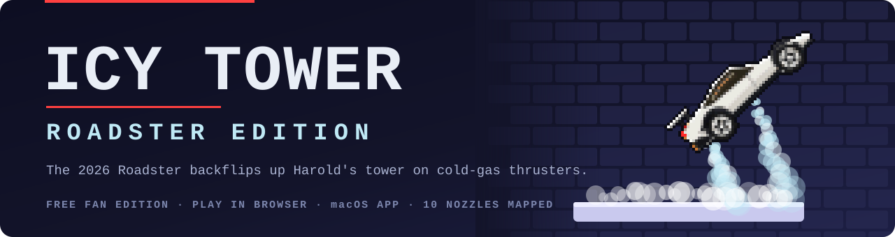
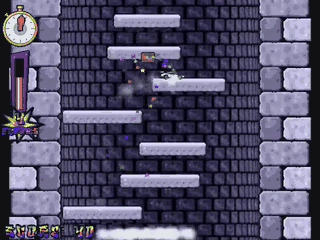
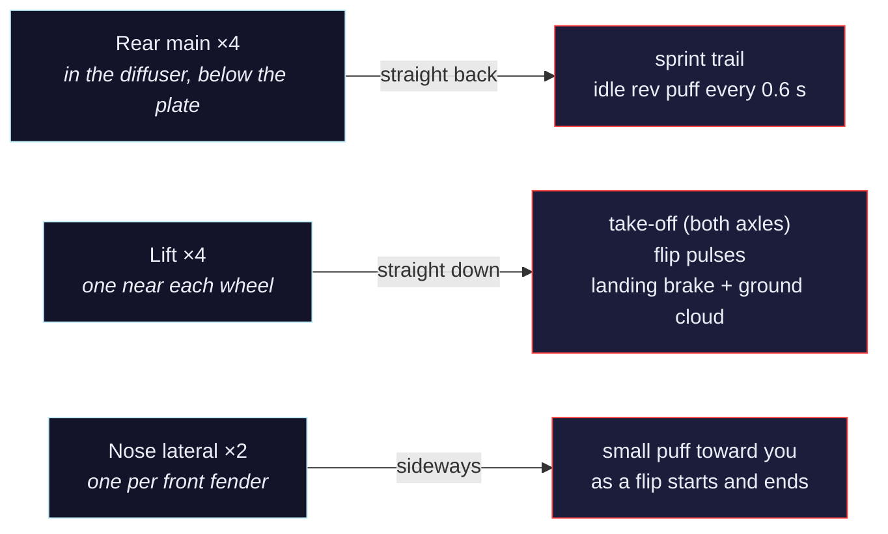
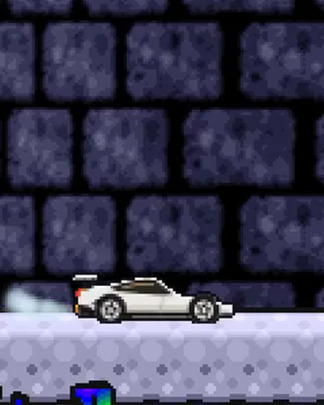
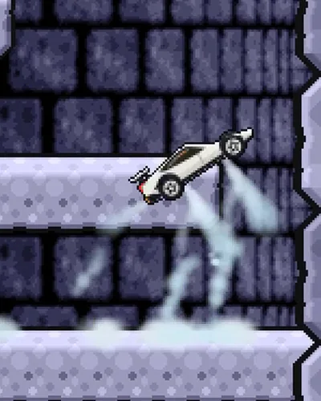
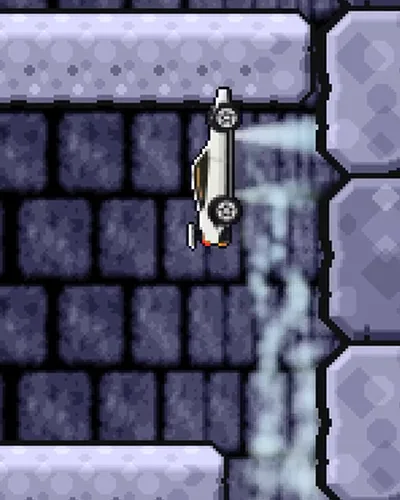
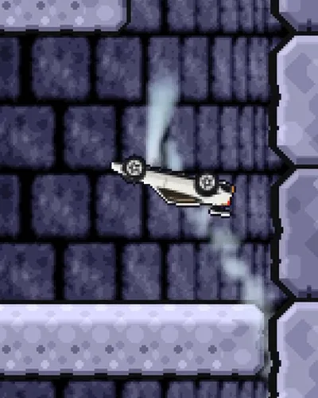
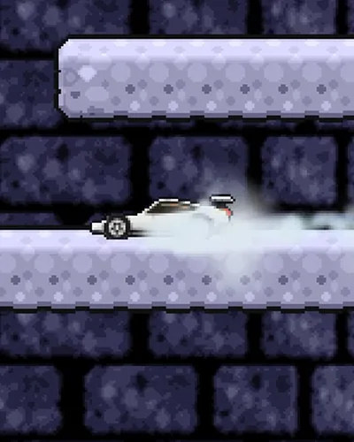
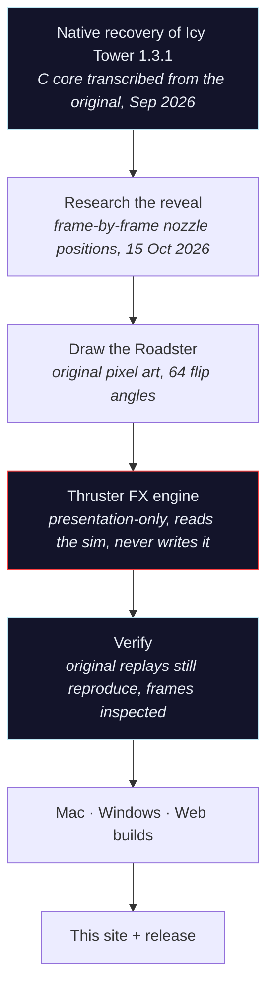

*The tower is of infinite height. The Roadster will never reach the top.*

<b>Fan recreation — not affiliated with or endorsed by Free Lunch Design. Icy Tower is © Johan Peitz / Free Lunch Design.</b>

**[▶ Play now](https://icytower.akeyo.io/play/)** · **[⬇ Download](#-get-it-in-30-seconds)** · **[🚀 The thrusters](#-where-the-gas-comes-out)** · **[🎯 1:1 faithful](#-11-faithful-the-original-game-not-a-lookalike)** · **[🧊 Credits](#-credits-free-lunch-design-first)** · **[🌐 Website](https://icytower.akeyo.io)**

5 seconds of real gameplay · <a href="assets/video/chars/roadster-sound.mp4">watch 13 s with sound</a> · the site also shows Harold, Disco Dave and the Template

---

## 🛑 The part that should stop you

Tesla showed the flying Roadster on **15 October 2026**. Within three days it was flipping up Harold's tower, and the gas comes out of the right places.

- **The jets follow the real nozzle layout.** Tesla's reveal footage was checked frame by frame: 4 rear main nozzles in the diffuser, 4 lift jets near the wheels, 2 nose laterals. Each one is mapped to a moment in the game ([table below](#-where-the-gas-comes-out)).
- **The nozzles are fixed to the body.** Mid-flip the "down" jets point *up*, exactly as in the inverted frames of Tesla's kickflip.
- **The game underneath is the original, not a lookalike.** Icy Tower 1.3.1 was transcribed routine by routine into a C core, and the 16 replays that ship with the 2001 game reproduce their recorded results on Mac, Windows and Web, hash for hash ([proof](#-11-faithful-the-original-game-not-a-lookalike)).
- **No sprite rotation jaggies.** Flips draw from 64 pre-rendered angles of original pixel art.

> [!IMPORTANT]
> A 2001 freeware classic and a 2026 rocket car, joined with care for both: the physics true to the old game, the thrusters true to the new car.

## ⚡ Get it in 30 seconds

| You're on | Do this |
|---|---|
| **Anything with a browser** (Linux, Chromebook, iPhone, Android, any PC) | Open **<https://icytower.akeyo.io/play/>** and play. |
| **Mac** (Apple Silicon, macOS 13+) | Download [`Icy-Tower-Roadster-mac.dmg`](https://github.com/fire17/icy-tower-roadster/releases/latest/download/Icy-Tower-Roadster-mac.dmg) → open it → drag the app onto Applications. Signed and notarized by Apple: it opens with no extra steps. Includes all 115 characters and their sounds. |
| **Windows** 10/11 64-bit | Download [`Icy-Tower-Roadster-windows.zip`](https://github.com/fire17/icy-tower-roadster/releases/latest/download/Icy-Tower-Roadster-windows.zip) → right-click → Extract All → run. SmartScreen: **More info → Run anyway**. |

> [!NOTE]
> On **macOS 15 or newer**, right-click → Open may not show an Open button. Go to **System Settings → Privacy & Security**, scroll down, and click **Open Anyway**. macOS and Windows ask once because the apps aren't notarized or code-signed; that costs money, and this project takes none.

### 🎮 Controls (the same keys as 2001)

| Key | Does |
|---|---|
| <kbd>←</kbd> <kbd>→</kbd> | run, and keep accelerating while held |
| <kbd>Space</kbd> | jump; the faster you run, the higher you go |
| <kbd>Esc</kbd> | pause |
| <kbd>R</kbd> | restart |
| <kbd>M</kbd> | mute |
| <kbd>C</kbd> | change climber |

The website rotates through four **editions** every ten seconds: Classic (Harold, with his big title-screen head), Disco Dave, Roadster and Template.

Four climbers: **the Roadster** (the default), **Harold**, **Disco Dave** and **the Template**. Every new game starts on the classic ice floors.

Bounce off the walls to keep your speed. Land two or more floors up to start a combo, and keep doing it before the meter runs dry. Jump fast enough and the car **backflips**.

## 🚀 Where the gas comes out

<table>
<tr>
<td align="center" width="20%"> <b>Idle rev</b> rear mains puff straight back</td>
<td align="center" width="20%"> <b>Take-off</b> both lift jets, clouds under the wheels</td>
<td align="center" width="20%"> <b>Nose up</b> front lift jet keeps firing alone</td>
<td align="center" width="20%"> <b>Upside down</b> body-fixed jets now point up</td>
<td align="center" width="20%"> <b>Landing</b> brake burst, gas splashes off the platform</td>
</tr>
</table>

The gas is cold-gas vapour: ice-cyan and white, **never orange, never flame**, because the real car's thrusters burn nothing. They blow compressed air at about 5,500 psi.

<b>The one liberty we took</b>

The real car did **barrel rolls** around its long axis. From the side, a roll just looks like the car showing its roof and then its belly, so in the tower it **backflips** instead. The flip is driven by the same nozzles: the front lift jet pushes the nose up, mid-flip pulses alternate front and rear, and a counter-burst near 300° settles the car level for landing.

<b>Sources for the Roadster facts</b>

- Electrek, 15 Oct 2026 — [the reveal and the kickflip](https://electrek.co/2026/10/15/tesla-unveils-cyberfied-new-roadster-kickflip/)
- TechCrunch, 15 Oct 2026 — [variants, thruster count](https://techcrunch.com/2026/10/15/tesla-reveals-spacex-powered-roadster-that-flies-and-falls-with-style/)
- paultan.org, 16 Oct 2026 — [nozzle layout, 0.81 s run, telemetry](https://paultan.org/2026/10/16/tesla-roadster-revealed-flies-on-spacex-air-thrusters-0-96-km-h-in-0-81s-production-2028/)
- EVXL, 16 Oct 2026 — [compressed-air tanks, rear nozzles](https://evxl.co/2026/10/16/tesla-roadster-thrusters-compressed-air-tank/)
- Space.com / VideoFromSpace — [Tesla's footage](https://www.youtube.com/watch?v=eqOfmtTJD1A), checked frame by frame for the jet positions
- NBC News — [barrel roll, landings in a cloud of condensation](https://www.nbcnews.com/tech/tech-news/elon-musk-shows-flying-tesla-roadster-years-delays-rcna603905)
- Wikipedia — [Tesla Roadster (second generation)](https://en.wikipedia.org/wiki/Tesla_Roadster_(second_generation))

## 🎯 1:1 faithful: the original game, not a lookalike

Every version runs **one C game core**, transcribed from Icy Tower 1.3.1. The test is the original game's own 16 replays. A replay records what the player pressed, not where they ended up, so if any physics rule were off by a hair, the run would drift and finish somewhere else.

| Platform | Result |
|---|---|
| 🍎 **Mac** (Apple Silicon) | **16/16** original replays reproduce their recorded score, floor and combo |
| 🪟 **Windows** 10/11 | **16/16**, tick for tick |
| 🌐 **Web** (WASM) | **16/16**, tick for tick |
| 🟰 **All three** | **145,141** per-tick full-state hashes, identical on Mac, Windows and Web · combined chain `ce0ab7382a9dd329` |

Not "close enough": the whole game state is hashed on every tick of every replay, and the three builds produce the same 145,141 hashes.

## 🧊 Credits: Free Lunch Design first

> **ICY TOWER © Johan Peitz / Free Lunch Design** — <https://www.freelunchdesign.com>
> Written, designed and drawn by Johan Peitz. Music and sound effects by Anders Svensson. Icy Tower is freeware.

The original readme asks for exactly one thing:

> *"Our only requirement is that you give proper credits to Free Lunch Design and provide a link back to our site. However, this game may not be included in a compilation or any other kind of commercial package without the permission from the author."*

How this edition honours it:

| Promise | How |
|---|---|
| Credit and a link back | On every page of the site, in this README, in the release notes and in [CREDITS.md](CREDITS.md) |
| Never commercial | Free forever, with no ads, no tracking and no donations; never bundled or sold |
| Their work stays theirs | The tower, Harold, the music, sounds, fonts and game data stay © Free Lunch Design and are **not** covered by our licenses |
| Easy to reach us | If you're from Free Lunch Design and want anything changed or taken down, [open an issue](https://github.com/fire17/icy-tower-roadster/issues) and it will be done |

> [!WARNING]
> **Unofficial fan project.** Not made or endorsed by Free Lunch Design. Tesla and Roadster are trademarks of Tesla, Inc., and SpaceX is a trademark of Space Exploration Technologies Corp. This project is unaffiliated with them and not sponsored or endorsed by them. The car is original pixel art; no Tesla logos or assets are used.

## 🛠️ How it was made

Made by fire17 & friends: one human and a team of AI agents. The thruster effects are **presentation-only**: they read the game state and never write it, so the original physics can't be disturbed. That is why the replays still reproduce after the car was added.

<b>Problems found and fixed along the way</b>

| Caught | Fix |
|---|---|
| Flips stopped at random angles and snapped upright on landing | While falling, the car finishes its current turn within about 9 ticks and then holds level |
| Rotating the sprite with nearest-neighbour sampling made it jagged | 64 angles pre-rendered from the vector art |
| In the original 480 px view, every flip's apex left the top of the screen | The trailer uses the portrait camera, which keeps whole flips in frame; the run's outcome is identical |
| The game's own mixer touched 0 dBFS when reward sounds overlapped | The trailer audio goes through a limiter (peak −1.0 dB) |

<b>What's in this repository</b>

| Path | What |
|---|---|
| `index.html`, `assets/css`, `assets/js` | The website: one static page in English and Hebrew, light and dark |
| `play/` | The browser build of the game |
| `assets/video/chars/` | Wide gameplay loops of all four climbers (muted, with posters) and a Roadster clip with sound |
| `assets/img/` | Roadster sprites, climber sprite sheets and ice/brick tiles (`img/game/`, made by `tools/make_site_assets.py`), gas stills, icons, social card |
| `.github/workflows/pages.yml` | Checks every local link, then publishes to GitHub Pages |
| `tools/check_links.py` | The offline link and anchor checker the workflow runs |
| `CREDITS.md`, `LICENSE` | Notices and licenses |

The Mac and Windows apps are attached to [Releases](https://github.com/fire17/icy-tower-roadster/releases), not committed here. The game's source lives in a separate repository, because the core is derived from Free Lunch Design's game.

## 🧹 Safety and uninstall

| | |
|---|---|
| **What the apps touch** | Mac: its own app bundle, its preferences and `~/Library/Application Support/Icy Tower Roadster/` (scores, last replay). Windows: its own folder and `%APPDATA%\Icy Tower Roadster\` (scores, settings, last replay) |
| **What there isn't** | No accounts, no telemetry, no ads |
| **Uninstall on Mac** | Drag the app to the Trash; optionally delete `~/Library/Application Support/Icy Tower Roadster/` |
| **Uninstall on Windows** | Delete the extracted folder; optionally delete `%APPDATA%\Icy Tower Roadster\` |
| **The website** | Static files. No cookies and no analytics; your theme and language choice are kept in your own browser's local storage |

## ⭐ One more floor

In Icy Tower, every floor you climb is worth 10 points. If this made you smile, a ⭐ is one more floor for the Roadster, and it tells Free Lunch Design that people still love their tower.

**[▶ Play in your browser](https://icytower.akeyo.io/play/)** · **[Free Lunch Design](https://www.freelunchdesign.com)**

Code: [MIT](LICENSE) · Roadster art and video: CC BY 4.0 · Icy Tower: © Free Lunch Design ([details](CREDITS.md))

Fan recreation — not affiliated with or endorsed by Free Lunch Design. Icy Tower is © Johan Peitz / Free Lunch Design.

<i>- The End -</i>

